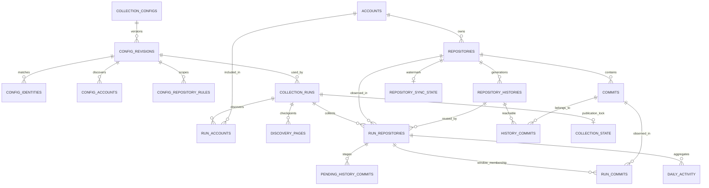

# Workforce

Read-only GitHub activity dashboard for **workforce.shazhou.work**, derived with
git-lineage from
[preset-cloudflare-fullstack](https://github.com/shazhou-ww/preset-cloudflare-fullstack).
React/Vite supplies the interface, a Hono Cloudflare Worker supplies the API,
Cloudflare Workflows collects GitHub history into D1, and Workers KV stores the
latest complete dashboard snapshot. No deployment or push is needed for local
development. Production collection runs hourly at minute 17 UTC; local
collection remains opt-in through its own D1 configuration.

## Workspace packages

The root package is `workforce`. Private workspace packages use the
`@shazhou-work/workforce-<role>` naming convention:

- `@shazhou-work/workforce-web` in `apps/web`: React/Vite frontend.
- `@shazhou-work/workforce-worker` in `apps/worker`: Cloudflare Worker API.
- `@shazhou-work/workforce-contracts` in `packages/contracts`: shared contracts.

Internal dependencies use `workspace:*`. This npm scope does not change the
GitHub repository location.

## What is counted

- Accounts and repository scope come from a versioned D1 configuration. Both
  user and organization accounts are supported. Choose all owned public
  repositories or an explicit public repository list; explicit exclusions win.
  Projects mean repositories, not GitHub Projects boards. Private repositories
  are excluded even if the collection token can access them.
- Last **30 Beijing calendar days**, including the partial current day. History
  is fixed to a single collection cutoff, using GitHub's committed timestamp
  rather than author date or push date.
- Only commits whose **primary author** matches any configured GitHub login or
  email, on each repository's **default branch**. Author emails are stored only
  in protected D1 configuration, never committed to source or exposed in public
  snapshots. Login and email comparisons are case-insensitive. Unlinked authors
  without a confirmed email are excluded; author names are never used as
  identity.
- Keep archived repositories, forks, and inherited history, but apply the same
  author filter to every history page. Committers and `Co-authored-by` trailers
  do not determine inclusion: a matching primary author with Copilot as
  co-author still counts; a bot primary author does not match merely because you
  merged it. Merge commits by a matching author still count and may include
  upstream code, so these are not original-authorship line counts. A SHA is
  counted once per repository, but can count again in another repository.
- Lines changed = GitHub commit **additions + deletions**. Average = total lines
  changed / commit count, not the average of repository or daily averages. Zero
  commits means zero average. Binary changes have no code-line equivalent.
- The project list shows the latest default-branch commit from **any author**,
  even when it falls outside the 30-day window or author filter; statistics
  columns use the author filter. This is repository activity, **not personal
  productivity** or a measure of code quality.

The repository list hides projects with zero additions plus deletions in the
selected period by default, even if they have commits. Toggle "显示零变化项目"
to include them. The count shows visible / total repositories. The composite
chart shows daily commit counts as bars (left axis) and daily additions plus
deletions as a line (right axis); the two axes scale independently. Borderless,
very light gray background bands beneath the gridlines mark Saturdays and
Sundays in the Beijing calendar; Monday through Friday retain a white
background. This distinction does not account for public holidays or
compensatory workdays. The legend explains the colors, and each day's tooltip
and accessible label include its weekday. Selecting a day updates the prominent
date, totals, and repository statistics; selecting it again or choosing
"查看 30 天合计" restores the full period. Search filters the repository list
only, not the global chart or totals. The browser re-reads the snapshot every
five minutes. Data older than three hours is visibly marked stale.

## Local development (PowerShell)

Use Node.js 24.11.1+ and pnpm 11.22+:

```powershell
pnpm install --frozen-lockfile
# Uses your existing GitHub CLI login; never print or commit this token.
$env:GH_TOKEN = gh auth token
# Optional confirmed author emails; use your own, never commit this value.
$env:GITHUB_AUTHOR_EMAILS = "author@example.com,another@example.com"
pnpm collect
Remove-Item Env:GH_TOKEN
Remove-Item Env:GITHUB_AUTHOR_EMAILS

# Optional offline bootstrap of local KV. Does not write to Cloudflare.
pnpm --filter @shazhou-work/workforce-worker exec wrangler kv key put activity:v1 --binding STATS --path ..\..\.data\snapshot.json --local
pnpm dev
```

Open `http://localhost:5173`. Vite proxies `/api/*` to the Worker on port 8787.
Local KV and D1 persist under the Worker's ignored `.wrangler` directory.
Generated offline snapshots are ignored under `.data`. For the D1/Workflow
collection path, also follow the local setup below.

The visual palette is derived from `--color-primary` in
`apps/web/src/styles.css`. Change that single base color to retune the
interface: `color-mix()` derives the deep chart line, light bars, text,
backgrounds, and borders. The line, markers, legend, and right axis share the
same deep tone. Weekend backgrounds use a fixed neutral light gray.
Addition/deletion and status colors retain their independent semantic meanings.
No runtime theme picker is required.

The public dashboard does not require OAuth secrets or sign-in. The template's
OAuth APIs remain available, with `/api/me` still protected. To use them, copy
`apps/worker/.dev.vars.example` to `.dev.vars`, generate a real `AUTH_SECRET`,
and configure the desired providers and callback URLs as described in the
template. Do not configure providers for the read-only public dashboard.

## Collection

### Cloudflare collection

```text
Cron / authenticated manual trigger
  -> ActivityCollection Workflow
  -> paginated account discovery and fixed repository heads
  -> D1 full-history initialization or incremental synchronization
  -> immutable 30-day daily aggregates
  -> complete KV snapshot
```

New repositories collect **all default-branch reachable history**, without a
`since` or `until` restriction. Adding an account only initializes newly
discovered repositories. Existing repository IDs keep their synchronization
state. All authors' commit details are cached; author filtering is applied when
building a run's statistics, not when fetching history.

Each repository records its last **fully successful** default branch and head
SHA. An unchanged head reuses cached history. A forward change uses fully
paginated comparisons between fixed SHAs and GraphQL batches for missing commit
details, including backdated commits introduced by merges. The planning
comparison's first page is checkpointed atomically with the repository plan and
reused during collection and retries, avoiding a duplicate API request.
Diverged/rewound history, branch changes, or an unavailable comparison base
rebuild the reachable history. A known SHA or a commit timestamp is never used
as a pagination stop.

Metadata and default-branch heads are fetched serially in GraphQL batches of at
most 10 repositories belonging to the same owner, using that owner's credential.
All results in a batch must pass the existing repository-ID and
public-visibility checks before any metadata is checkpointed. Checkpoints are
written atomically to D1 and reused after retries or Workflow replay; planning
and history progress remain per repository. A failed batch never publishes a
partial snapshot.

Structured Worker logs with event `collection.github_request` record every
actual HTTP attempt (including retries), REST/GraphQL classification, duration,
authentication presence, HTTP status, and numeric GitHub rate-limit headers.
They never log credentials, request bodies, or raw response data.
`collection.invocation` summarizes request counts and active callback time for
discovery, metadata, planning, history, aggregation, and publication. Counts are
per invocation, not durable run totals: Workflow replay skips completed
callbacks and a resumed invocation reports only its new work. Active time
excludes Workflow rate-limit sleeps; invocation wall time can include
orchestration waits. Compare equivalent repository scopes and synchronization
modes across runs, and sum invocation counts when evaluating a run with multiple
resumes. REST requests and GraphQL requests are counts, not interchangeable
GitHub rate-limit points.

Administrators can open the floating performance panel from the collection
controls without expanding the page header. Click outside, press Escape, or use
the same button to close it. It shows elapsed and active processing time,
REST/GraphQL request counts, extra step executions, rate-limit wait counts/time,
and per-phase timings. Running tasks refresh with the progress poll; completed
metrics survive page refreshes. The protected progress API returns
`performance: null` for old tasks without recorded attempts, not fabricated zero
measurements. Public visitors receive neither task IDs nor performance data.

Migration `0002_collection_performance.sql` persists one immutable metrics row
per actual callback execution, with a unique attempt ID. Replaying a completed
Workflow step does not execute or record the callback again; an actual retry
counts its newly issued requests. Rate-limit waits use stable run/step keys and
durable start/finish markers, so replay cannot double-count them. Active timings
exclude the metrics write itself and Workflow sleeps. Terminal elapsed time ends
at the last recorded measurement or publication timestamp; for a cancelled task
it is the recorded span, not an exact cancellation timestamp. Only numeric
request counts and timings are stored, never tokens or raw GitHub responses.
Apply the pending D1 migrations before deploying code that records metrics:

```powershell
pnpm --filter @shazhou-work/workforce-worker exec wrangler d1 migrations apply DB --remote
```

Account identities are reused from D1; a previously unknown account uses an
explicitly public profile request without an Authorization header. Only login,
account type and database ID are persisted. Public account identities can also
be seeded by an authorized operator during configuration bootstrap. Users'
public owned repository lists, commit GraphQL queries and comparisons use
`GH_TOKEN`. Organizations are discovered through the explicitly public
`/orgs/{org}/repos?type=public` directory. When an owner-specific
`GH_TOKEN_<UPPERCASE_OWNER>` is configured, discovery uses that credential to
avoid the anonymous IP quota; otherwise it retains anonymous discovery rather
than using the personal token. The organization credential must authorize this
endpoint as well as repository reads; an authorization failure is surfaced
without silently retrying anonymously. A repository owner-ID mismatch fails
explicitly rather than publishing an empty result for a reused account name.
This avoids repeated anonymous profile requests. Unknown-account lookup and
organization discovery without an override remain subject to GitHub's
unauthenticated IP rate limit (60 requests/hour/IP). Workflows wait for the
reset rather than silently skipping organizations or publishing partial results.

Commit identity is `(repository_id, sha)`, not a global SHA. Each page
atomically writes details, staged membership and its checkpoint. Only a
completed repository merges its staged membership into its cached history,
creates the run's 30-day membership and daily aggregates, and advances its
watermark. Old commit records remain available after force-pushes but are not
counted unless reachable from the new head. Full-history generations are shared
across normal forward runs rather than copying all history every hour.

Workflow steps retry transient failures; HTTP rate-limit responses sleep until
the reset deadline, and GraphQL rate-limit errors conservatively wait an hour.
Authorization failures are not retried. Rejection logs include a sanitized
GitHub reason and its advertised required permissions, without raw response
messages, tokens or IP addresses. Public-repository access does not guarantee
access to every account-profile endpoint or bypass organization policies.
Invalid data, missing/private repositories and exhausted retries fail
explicitly. The previous KV value stays available until the **whole** run
succeeds.

There is one publication lock per dashboard, stored in D1, with no unsafe
time-based expiry. Overlapping runs and cutoffs older than the last publication
attempt are blocked. The cutoff fence is recorded before writing KV and survives
cancellation, so an ambiguous KV write cannot later be overwritten by an older
run. A failed Workflow retains the lock for safe retry. D1 and KV do not share a
transaction: a run becomes `ready`, writes a complete KV value, then records
`published` and releases the lock. Retrying publication is idempotent. The
legacy Actions workflow no longer schedules or writes production KV; it only
produces a manually requested offline artifact.

### Private configuration and management

The default dashboard has immutable configuration revisions. Each run pins its
revision and cutoff; changing a configuration does not alter a running or
historical run. Scope is:

```text
(owned public repositories, when enabled by mode, UNION explicit includes)
MINUS explicit excludes
```

Repository rules use `owner/name`; GitHub redirects are followed, and exclusions
are also resolved to IDs to survive repository renames. Update configuration
names when accounts or repositories are renamed. Explicitly configured
unavailable repositories, including exclusion lookups, fail visibly.

Management uses a separate `COLLECTION_ADMIN_TOKEN` bearer secret of at least 32
characters. OAuth sessions do not grant collection administration and the
existing `/api/me` authorization remains unchanged. Management responses use
`Cache-Control: no-store`; no management route is publicly readable.

| Endpoint                               | Purpose                                                                       |
| -------------------------------------- | ----------------------------------------------------------------------------- |
| `GET /api/collection/config`           | Current revision, private identities/scope and scheduling flag                |
| `PUT /api/collection/config`           | Validate and activate a new immutable revision                                |
| `POST /api/collection/runs`            | Explicit manual collection, even with scheduling disabled                     |
| `GET /api/collection/runs`             | Publication lock and latest 20 run records                                    |
| `POST /api/collection/runs/:id/retry`  | Restart an errored Workflow that still owns the lock                          |
| `POST /api/collection/runs/:id/cancel` | Release an errored/terminated Workflow's lock and permanently cancel that run |

Cancellation never stops a live Workflow behind its back: terminate it in
Cloudflare first if it is still running. Cancelled or published runs cannot
acquire the lock again.

Configuration requires all fields below; arrays are limited to 100 entries each,
normalized case-insensitively and deduplicated:

```json
{
  "enabled": false,
  "accounts": ["shazhou-ww"],
  "authorLogins": ["shazhou-ww"],
  "authorEmails": [],
  "repositoryMode": "all_owned_public",
  "includeRepositories": [],
  "excludeRepositories": []
}
```

Use `repositoryMode: "explicit"` with a nonempty `includeRepositories` list to
collect only selected public repositories. Configure at least one author login
or email; matching is OR, based on primary authors only. Enter real author
emails through the protected API, never in checked-in configuration.

Commit rows store normalized author login and an **HMAC-SHA256 email
fingerprint**, not plaintext author emails. `COLLECTION_EMAIL_KEY` is an
independent stable secret of at least 32 characters. Adding email identities can
re-filter existing full-history data without GitHub requests. Key changes fail
explicitly; if the key is lost or must be rotated, bootstrap a fresh database
and rebuild full history with the new key rather than silently mixing
fingerprints. Credentials and fingerprints are never exposed in snapshots.

### D1 model



The schema is in `apps/worker/migrations/0001_collection.sql`. UTC timestamps
use ISO 8601 text; daily dates use Beijing `YYYY-MM-DD`. Average line changes
are derived from weighted totals, not persisted averages. R2 is not required.
Historical retention/compaction is not automatic: full history and completed run
statistics are retained, so monitor D1 storage as usage grows.

### Local D1 and Workflow setup (no cloud writes)

Copy `.dev.vars.example` to `.dev.vars` and set `GH_TOKEN`,
`COLLECTION_ADMIN_TOKEN` and `COLLECTION_EMAIL_KEY`. Use an independent GitHub
credential that can read public repositories and call GraphQL; never put it in
the browser or D1. No private-repository permission is required.

```powershell
pnpm --filter @shazhou-work/workforce-worker exec wrangler d1 migrations apply DB --local
pnpm dev

# Run in another terminal; load your management token without committing it.
$headers = @{ Authorization = "Bearer $env:COLLECTION_ADMIN_TOKEN" }
$config = @{
  enabled = $false
  accounts = @("shazhou-ww")
  authorLogins = @("shazhou-ww")
  authorEmails = @()
  repositoryMode = "all_owned_public"
  includeRepositories = @()
  excludeRepositories = @()
} | ConvertTo-Json
Invoke-RestMethod http://localhost:8787/api/collection/config -Method Put -Headers $headers -ContentType application/json -Body $config
Invoke-RestMethod http://localhost:8787/api/collection/runs -Method Post -Headers $headers
Invoke-RestMethod http://localhost:8787/api/collection/runs -Headers $headers
```

The checked-in D1 binding points to the production `workforce-activity` database
in this Cloudflare account. `--local` still uses local storage and does not
write to production. Reuse the existing database for this account; create and
bind a different database only when bootstrapping another environment.
Production collection must respect the account's Workers, Workflows, D1, and
GitHub quotas; large first-time histories may require a paid plan.

### Create and configure the GitHub credential

Create a dedicated
[fine-grained personal access token](https://github.com/settings/personal-access-tokens/new):

- Name: `workforce-cloudflare-collector`.
- Expiration: 90 days, or your organization's shorter lifetime policy.
- Resource owner: your GitHub account.
- Repository access: **Public repositories**, read-only.
- Do not add private-repository access, write, administration or workflow
  permissions. Fine-grained tokens always include read-only public access,
  including public repositories belonging to other accounts.

GitHub documents public read access for fine-grained tokens in
[its GraphQL authentication guide](https://docs.github.com/en/graphql/guides/forming-calls-with-graphql).
Validate the actual collection after setup; do not broaden permissions blindly
if a request fails.

Never send the token in chat, put it in a repository variable, or commit it.
Configure it as a **Worker Secret**: Cloudflare dashboard -> Workers & Pages ->
`workforce` -> Settings -> Variables and Secrets -> Add -> type **Secret** ->
name `GH_TOKEN`. Alternatively, run from the repository root and enter the token
at Wrangler's masked prompt:

```powershell
pnpm --filter @shazhou-work/workforce-worker exec wrangler secret put GH_TOKEN
```

This configures production, not `.dev.vars` and not GitHub Actions secrets. For
local collection, separately set `GH_TOKEN` in the ignored `.dev.vars`. Renew
the token before expiration and update the same Worker secret; do not rotate
`COLLECTION_EMAIL_KEY` when renewing a GitHub token.

For an organization requiring a separate credential, create a fine-grained token
with that organization as **Resource owner**, **Only select repositories**
containing the public repositories to collect, and **Contents: Read-only**
(**Metadata: Read-only** is automatically included). Wait for organization
approval if required. Do not select private repositories or grant write/admin
permissions.

Keep the existing `GH_TOKEN` for personal repositories. Organization repository
discovery, repository metadata, history, comparisons and commit details prefer
the owner-specific Worker Secret `GH_TOKEN_<UPPERCASE_OWNER>`, replacing
owner-name hyphens with underscores:

```powershell
pnpm --filter @shazhou-work/workforce-worker exec wrangler secret put GH_TOKEN_SILVERMOON_WORK
```

For `silvermoon-work`, select the now-public `task-engine` repository. Configure
additional public repositories in that token when needed. Omit unused overrides;
an explicitly empty override fails instead of silently falling back. Without an
override, repository reads retain the existing `GH_TOKEN` behavior. Tokens never
enter D1 configuration or public snapshots, and credential selection does not
change the public-only collection policy or author filter. The optional offline
`pnpm collect` command continues to use its single `GH_TOKEN`.

During this account's initial bootstrap, the two independent random collection
secrets are backed up with Windows DPAPI encryption at
`$env:LOCALAPPDATA\Workforce\collection-secrets.clixml`, outside the repository.
Only the same Windows user on the same machine can decrypt this backup. Use a
secure password manager for additional recovery copies; never print the values
or upload the file as a public artifact. To call the management API locally:

```powershell
$credentials = Import-Clixml "$env:LOCALAPPDATA\Workforce\collection-secrets.clixml"
$admin = $credentials | Where-Object UserName -eq "COLLECTION_ADMIN_TOKEN"
$headers = @{ Authorization = "Bearer $($admin.GetNetworkCredential().Password)" }
Invoke-RestMethod https://workforce.shazhou.work/api/collection/runs -Headers $headers
```

### Offline collector

`pnpm collect` remains available as a separate 30-day offline/bootstrap tool. It
uses `GH_TOKEN`, comma-separated `GITHUB_ACCOUNTS` (default `shazhou-ww`),
`GITHUB_AUTHOR_LOGIN` (default `shazhou-ww`) and `GITHUB_AUTHOR_EMAILS`, not D1
configuration. It writes `.data/snapshot.json` only on complete success and does
not advance D1 watermarks or publish KV. Snapshot `authorFilter` metadata
contains public logins and an email-matching flag, never email addresses. Legacy
snapshots without this metadata remain explicitly labeled all-author.

## Deployment

1. The production `STATS` namespace is already bound in the checked-in
   configuration. Reuse it for this account. Only when bootstrapping another
   account or environment, create a new namespace:

   ```powershell
   pnpm --filter @shazhou-work/workforce-worker exec wrangler kv namespace create STATS
   ```

2. If you created a new namespace, replace its ID in
   `apps/worker/wrangler.jsonc` with the returned ID. The config declares Worker
   name `workforce`, but intentionally omits `routes`: routine deployments do
   not manage domain bindings. `workers_dev: false` keeps the workers.dev
   endpoint disabled even without routes in the config.
3. For an initial local bootstrap, collect data as above and publish the
   snapshot. Subsequent CI deployments use release tags as described below:

   ```powershell
   pnpm --filter @shazhou-work/workforce-worker exec wrangler kv key put activity:v1 --binding STATS --path ..\..\.data\snapshot.json --remote
   pnpm check
   pnpm run deploy
   ```

   For a new environment only, open the Cloudflare dashboard after deploying:
   Workers & Pages -> workforce -> Settings -> Domains & Routes -> Add -> Custom
   Domain, and bind `workforce.shazhou.work`. The domain's zone must be in that
   account. Inspect any existing hostname configuration before approving
   replacement. This one-time setup creates routing and the certificate; the
   existing production binding does not need to be recreated. Subsequent
   deployments preserve that binding without calling the custom domain
   management API.

4. Configure these GitHub `production` environment secrets:

   | Secret                  | Purpose and permission                                     |
   | ----------------------- | ---------------------------------------------------------- |
   | `CLOUDFLARE_ACCOUNT_ID` | Deployment account ID                                      |
   | `CLOUDFLARE_API_TOKEN`  | Deployment only: Individual Workers → `workforce` → Editor |

   Collection uses Worker bindings and the Worker `GH_TOKEN` secret, not a
   Cloudflare API token. The legacy `CLOUDFLARE_KV_API_TOKEN` Actions secret is
   no longer used by the checked-in offline workflow. Wrangler expects the
   deployment token in `CLOUDFLARE_API_TOKEN`. See the current
   [Workers roles and permissions](https://developers.cloudflare.com/workers/authorization/workers/).
   Deploying with an existing KV binding does not require KV permissions.
   Routine releases need no Zone Read or Workers Routes Write permissions: they
   update the Worker and assets, not Routes or Custom Domains. Domain setup or
   changes are performed separately by an authorized operator in the Cloudflare
   dashboard.

   Restrict account resources to the deployment account. Do not add zone
   permissions to the routine deployment token. This app uses
   [Custom Domains](https://developers.cloudflare.com/workers/configuration/routing/custom-domains/),
   rather than manually managed DNS records. No DNS Edit, Pages, R2, or Global
   API Key is needed. D1 provisioning and migration permissions are needed
   separately when bootstrapping the collection database. Avoid a fixed IP
   restriction for GitHub-hosted runners unless using controlled egress. Keep
   the token only in Actions secrets, never in code or chat.

5. Only when explicitly bootstrapping production collection:

   - Reuse the bound D1 `workforce-activity` database and apply its migrations
     with `--remote`. Create and replace the binding only for a new environment.
   - Set Worker secrets `GH_TOKEN`, `COLLECTION_ADMIN_TOKEN`, and the stable
     `COLLECTION_EMAIL_KEY` using `wrangler secret put`.
   - Save configuration through the protected API and manually collect once.
   - After verifying the complete KV result, explicitly set configuration
     `enabled: true`, `COLLECTION_ENABLED: "true"` and
     `triggers.crons: ["17 * * * *"]` to opt into hourly UTC scheduling.

   Do not enable the legacy Actions schedule or its KV publisher. Cron is a
   trigger, not a freshness guarantee: inspect Workflows and the protected run
   API when data becomes stale. `/api/health` remains liveness only.

6. Deploy by pushing a release tag, **not** by pushing `main` or manually
   dispatching the deployment workflow. The production D1 binding is already
   provisioned for this account:

   ```powershell
   git tag -a Release-261105-1 -m "Release 2026-11-05 #1"
   git push origin Release-261105-1
   ```

   Tags use `Release-YYMMDD-INDEX`: the release date and that day's release
   sequence, starting at `1`, without leading zeros. For example, the next
   release on 2026-11-05 is `Release-261105-2`. Choose the next unused sequence
   manually; do not move or reuse published tags. The workflow validates the
   name and calendar date before building and deploying the tagged commit.
   Malformed `Release-*` tags fail validation without deploying.
   `CLOUDFLARE_DEPLOY_ENABLED` is no longer used. If the `production`
   environment restricts deployment refs, allow `Release-*` tags. Scheduled data
   collection remains independently disabled until both Cloudflare scheduling
   switches and its cron are explicitly enabled.

GitHub Actions' automatic token is used only by the optional offline collector.
Cloudflare collection uses the independent Worker `GH_TOKEN` secret. Check
failed runs instead of treating an old snapshot as current. Public repository
descriptions and commit subjects are intentionally exposed on the public
dashboard; do not extend collection to private data without access control.

## Manual collection in the dashboard

The public dashboard stays readable without signing in. Its header provides
administrator sign-in; authenticated authorized users see **手动采集**. The
button is disabled while starting or monitoring a run, shows repository progress
and rate-limit waits, and refreshes the dashboard immediately after a complete
snapshot becomes visible. Failed collection or refresh retains the previous
complete data; an older in-flight response cannot overwrite a newer snapshot.

Authorization uses the immutable GitHub account ID in the encrypted Auth.js JWT,
set only from the verified GitHub OAuth account. The checked-in
`COLLECTION_ADMIN_GITHUB_IDS=242885595` allows `shazhou-ww`; use comma-separated
numeric GitHub IDs to configure another administrator. Names, emails, browser
flags and session-update input cannot grant collection permission. The Worker
checks the allowlist for every request and rejects cross-origin triggers.

Create a dedicated
[GitHub OAuth App](https://github.com/settings/applications/new) for sign-in,
**not a personal access token**:

- Homepage URL: `https://workforce.shazhou.work`.
- Authorization callback URL:
  `https://workforce.shazhou.work/api/auth/callback/github`.
- Use its Client ID and Client Secret for `AUTH_GITHUB_ID` and
  `AUTH_GITHUB_SECRET`. Collection PATs remain separate and unchanged.
- Configure an independent random `AUTH_SECRET` of at least 32 characters. Keep
  it stable to preserve encrypted sessions. This account's bootstrap keeps its
  Windows DPAPI-encrypted recovery copy at
  `$env:LOCALAPPDATA\Workforce\auth-secret.clixml`, outside the repository.

```powershell
pnpm --filter @shazhou-work/workforce-worker exec wrangler secret put AUTH_GITHUB_ID
pnpm --filter @shazhou-work/workforce-worker exec wrangler secret put AUTH_GITHUB_SECRET
# Required only when AUTH_SECRET has not already been provisioned.
pnpm --filter @shazhou-work/workforce-worker exec wrangler secret put AUTH_SECRET
```

Enter secrets at the masked prompt or use the Cloudflare dashboard; never send
them in chat or commit them. For local OAuth development, configure a separate
OAuth App with callback `http://localhost:5173/api/auth/callback/github`, and
use the ignored `.dev.vars` with `AUTH_URL=http://localhost:5173/api/auth`. The
configured auth origin is also the allowed trigger origin when using Vite's
same-origin API proxy.

| Endpoint                                | Access and purpose                                                                                     |
| --------------------------------------- | ------------------------------------------------------------------------------------------------------ |
| `GET /api/activity/collection`          | No-store sign-in availability, current user's permission, and an active run ID only for administrators |
| `POST /api/activity/collection`         | Administrator Auth.js session plus same-origin request; starts a complete collection                   |
| `GET /api/activity/collection/runs/:id` | Administrator session; reports persisted run progress and actual Workflow waiting/failure state        |

These session endpoints never expose collection tokens or private author
configuration. The original `/api/collection/*` management API still requires
its separate bearer credential; a GitHub session does not grant configuration or
cancellation access. Workflow creation persists a queued record before
acknowledgment, and creation failures are logged and recorded explicitly.

## API

- `GET /api/activity`: typed `ActivitySnapshot`, with 30 zero-filled daily
  buckets, weighted totals, repository metadata, and per-repository daily data.
  Cached publicly for 60 seconds; KV publication is eventually consistent.
- Before the first snapshot: **503** with setup guidance, not fake zero metrics.
- KV failures: logged server-side and returned as **500** with a safe message.
- `GET /api/health`: Worker liveness only; it does not assert data freshness.

## Commands and lineage

| Command              | Purpose                                                             |
| -------------------- | ------------------------------------------------------------------- |
| `pnpm collect`       | Collect public GitHub data to an ignored local snapshot             |
| `pnpm dev`           | Run Vite and the local Worker                                       |
| `pnpm check`         | Format, lint, type-check, tests with 90% coverage thresholds, build |
| `pnpm build`         | Build shared contracts, web assets, and dry-run the Worker          |
| `pnpm run deploy`    | Build and deploy the Worker and assets (explicit opt-in)            |
| `git-lineage update` | Merge updates from the immediate fullstack template                 |

The immediate parent is recorded in `.git-lineage.yaml`. Its source commit is
`48a07c6882f347f736a16f1d69b9e9922ae08111`; the verified derivation birth commit
is `8973dcea1e5b30ed1202a99c95547f094406ac7d`. Child work stays in this
repository.

## License

MIT
